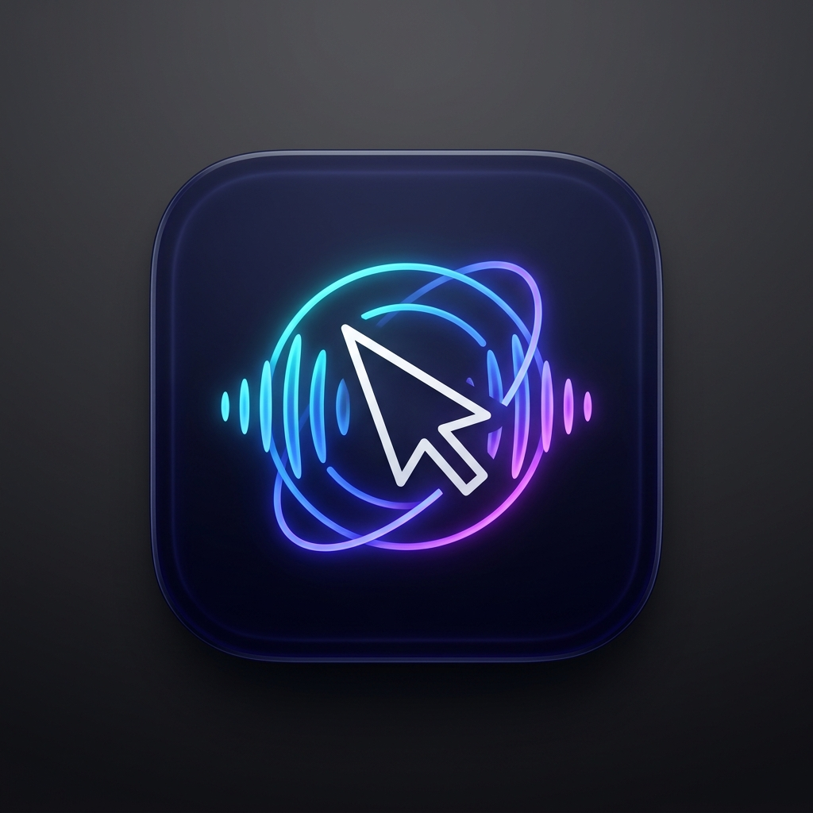

  

<h1 align="center">AeroPoint</h1>

  <b>Next-Generation Hands-Free Spatial Mouse for Mac.</b> 
  Turn your head to point. Rest on a button to click. Control with AirPods in ear or in hand.

  Created, Designed & Developed by <b>Shreesha Anand Pujar</b>

  
  
  
  
  

  

  <a href="https://github.com/ShreeshaAnandPujar/AeroPoint/releases/download/v1.1.0/AeroPoint.zip"><b>Direct Download Link: AeroPoint.zip (v1.1.0)</b></a>

---

## Author & Creator

  <h3>Shreesha Anand Pujar</h3>
  
<b>Lead Architect, Interaction Designer & Developer</b>

  

    
    
  

  
AeroPoint is an independent spatial interaction platform engineered by <b><a href="https://www.linkedin.com/in/shreesha-anand-pujar-ba1b96369/">Shreesha Anand Pujar</a></b>, transforming Apple AirPods motion hardware into a sub-millimeter accurate spatial pointer for macOS. Built with relative velocity mapping, real-time CoreMotion telemetry, smart dwell element filtering, and ultra-sync zero-lag responsiveness.

---

## ⚡ Quick Start: Download & Install (60 Seconds)

1. Click the **[Download for Mac](https://github.com/ShreeshaAnandPujar/AeroPoint/releases/download/v1.1.0/AeroPoint.zip)** button above to get `AeroPoint.zip`.
2. Double-click `AeroPoint.zip` to unzip it.
3. Drag **`AeroPoint.app`** into your Mac's **`/Applications`** folder.
4. Launch **AeroPoint** from Applications or Spotlight:
   - Follow the interactive Guided Tour to grant local **Accessibility** (to move cursor) and **Motion** (to read AirPods sensors) permissions.
5. Put in your AirPods (or hold one in hand in Wand mode) — spatial pointer tracking begins immediately!

---

## What You Can Do

| You Do | AeroPoint Does |
|---|---|
| **Turn your head (In-Ear)** | Moves pointer smoothly across all connected Mac displays |
| **Hold 1 AirPod in hand (Wand mode)** | **In-Hand Air Mouse:** Point forward like a laser wand. Tap stem 1× for Left Click, 2× for Right Click |
| **Rest pointer on a button** | **Smart Hover Click:** Subtle ring fills, then clicks. Ignores plain reading text |
| **Press AirPods stem once** | Left click |
| **Press AirPods stem twice** | Right click |
| **Press AirPods stem 3 times** | Scroll mode: look or point up/down/left/right to scroll |
| **Nod gently** | Instant left click, landing precisely where you aimed |
| **Shake your head** | Pause / resume tracking |
| **Tilt left / right** | Remappable: Back/Forward, Spaces, Mission Control, Spotlight |
| **Press ⌃⌥P** | **Precision Sniper Mode:** Drops pointer speed to 35% for pixel-perfect targeting |

---

## Key Features & Engineering Innovations

### 1. ⚡ Ultra-Sync 100% Real-Time Motion Synchronization
Engineered with dynamic velocity-adaptive smoothing that automatically reduces retention damping during active movement. This eliminates sluggish trailing latency for an instantaneous 1:1 real-time connection between head/hand movement and the cursor, while snapping rock-steady to zero when you stop moving.

### 2. 🪄 In-Hand Air Mouse Wand Mode (Single AirPod Control)
Switch from In-Ear Head Tracking to **In-Hand Air Mouse Wand** with a single click in the menu bar or dashboard. Hold one AirPod between your fingers like a presentation remote:
- **Point to steer**: Pitch and yaw wrist rotation maps smoothly to cursor trajectory.
- **Stem Tap 1×**: Left Click.
- **Stem Tap 2×**: Right Click.
- **Software Isolation**: Head nods, shakes, and typing pause guards are automatically suppressed in hand mode so wrist waving never triggers accidental clicks.
- **Inaudible Audio Keep-Alive**: Automatically keeps the Apple CoreMotion stream active even when the AirPod is outside your ear.

### 3. 🎯 Precision Sniper Mode (`⌃⌥P`)
Instantly drops cursor speed to 35% (customizable 10%–70%) for pixel-accurate work in CAD, Figma, video editing, or tiny web controls.

### 5. ⌨️ Intelligent Keyboard Guard (Typing Auto-Pause)
Automatically analyzes your head's pitch angle in real-time. When looking down at your keyboard or laptop (`pitch < -22°`), pointer movement is instantly frozen so typing never jostles your cursor. Resumes automatically when looking back up at your display.

### 6. 🎛 5 Engineered Motion Presets
- **Standard Head**: Balanced velocity, gentle acceleration, and comfortable dead zone.
- **In-Hand Wand**: Tuned for handheld wrist pointing with 1.35× speed, 1.5° deadzone, and 0.22 smoothing.
- **Design & CAD**: Ultra-smooth with 75% dampening and 20% precision multiplier.
- **Fast Navigation**: Snappy acceleration and high sensitivity for wide multi-monitor workflows.
- **Relaxed Reading**: Expanded 8° dead zone that stays rock-solid while reading documents.

### 7. 🛡 Screen Edge Resistance
Gently decelerates pointer velocity by 40% near display boundaries to prevent overshooting off the screen or drifting erratically between monitors.

### 8. 🔒 100% Offline & Private by Design
Motion data is processed strictly in-memory on your Mac. No network calls, no analytics, no third-party trackers, and no telemetry.

---

## Requirements & Compatibility

- **Operating System**: macOS 15 Sequoia or later (Apple Silicon M1/M2/M3/M4 & Intel).
- **Compatible Audio Hardware**:
  - AirPods Pro (1st, 2nd gen)
  - AirPods Max
  - AirPods (3rd, 4th generation)
  - Beats Fit Pro

---

## Connect with the Developer

- **Creator & Lead Developer**: Shreesha Anand Pujar
- **LinkedIn**: [https://www.linkedin.com/in/shreesha-anand-pujar-ba1b96369/](https://www.linkedin.com/in/shreesha-anand-pujar-ba1b96369/)
- **GitHub**: [https://github.com/ShreeshaAnandPujar](https://github.com/ShreeshaAnandPujar)

---

## License

[MIT License](LICENSE) © 2026 **Shreesha Anand Pujar**. All rights reserved.

AirPods, AirPods Pro, AirPods Max, Beats, and macOS are trademarks of Apple Inc., registered in the U.S. and other countries. AeroPoint is an independent project by Shreesha Anand Pujar and is not affiliated with, sponsored by, or endorsed by Apple Inc.
